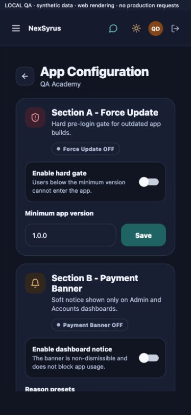

# NexSyrus SuperAdmin — Phase 8 final report

30 October 2026 · Local QA of the cumulative transformation workspace.

**Status: QA fixes applied; release sign-off is blocked.** Frontend checks and all three JavaScript exports pass. The complete backend run has 171 passes and three failures caused by absent sibling-project files. Native-device, live-service and full accessibility acceptance are outstanding. This report does not certify every workflow or every state as complete.

## 1. Architecture

The application retains Expo Router, React Native and React Native Web, with the existing Express/PostgreSQL backend. The transformation is organized around shared UI, a persistent workspace shell, feature screens and existing service/API layers. It is an incremental consolidation, not a replacement of business services or schemas.

`ThemeProvider` owns appearance and accessibility preferences. `WorkspaceThemeProvider` supplies functional module accents from the route. `DashboardLayout` supplies navigation, top bar and responsive content. Feature screens consume shared forms, actions, metrics, tables, notices and recovery components. Connect keeps its dedicated collaboration layout. Books keeps its company-scoped navigation and accounting services.

Frontend route permissions remain in `AppRouteGuard`/`RouteGuard`; backend middleware remains the authority for sessions, permissions and school/company scope. QA fixed identity resolution: a matching email cannot replace the verified token subject, remote user metadata cannot replace trusted identity claims, internal JWTs with the wrong audience cannot fall back to legacy authentication, and unexpected directory failures fail closed. Legacy founder profile responses preserve the difference between scoped founders and platform administrators.

No production migration, deployment, commit, push or production-data modification was performed. Existing uncommitted work from earlier phases was preserved.

## 2. Navigation

The shared shell groups Overview, Collaboration, Management, Operations, Business & Audit, Infrastructure and Sales Enablement. A permission-filtered **page finder** helps locate navigation destinations. It searches pages; it is not universal entity search.

The deepest matching navigation item is active. Desktop uses a persistent collapsible sidebar. Widths below 1024px use a modal drawer, recovering usable tablet content width. Browser/platform back, safe fallback destinations and real breadcrumb parents support detail navigation. Unknown routes have a recovery page; render failures have an error boundary.

The static audit found **229 literal destinations with no unresolved route references**. The browser matrix opened **73 routes**, including `/console/books` → `/books` and `/console/collections` → billing collections. The production web export sent an unauthenticated school-configuration deep link to sign-in, and its CA sign-in link opened correctly. Native URL schemes, Android system back and authenticated production deep-link restoration are not accepted by these checks.

## 3. Design system

Shared tokens cover light/dark surfaces, readable text, semantic statuses, functional module colours, spacing, type, radii, elevation and responsive layout. Blue identifies overview, teal school operations, green finance, violet collaboration/content, rose teams and amber sales. Colour is accompanied by text/icons.

Filled actions use `primaryFill` with readable white labels; a lighter dark-theme accent is reserved for appropriate foreground use. Shared controls use visible focus and 44px targets. Tables become labelled cards on narrow screens. Shared forms expose labels, required/invalid/error associations. Explicit ARIA selection/expansion/check/busy states bridge the installed React Native Web version, which drops some legacy accessibility-state props.

OS/web reduced-motion and reduced-transparency subscriptions are available. Legacy Animated loops can stop when preferences change; motion can complete immediately. Shared blur surfaces were removed or replaced with opaque surfaces. Sign-in now follows both themes. **The complete app is not certified free of legacy animation or translucent decorative styling.** Authentic refractive Liquid Glass from the master brief is not implemented; the shipped shared treatment prioritizes opaque readable surfaces.

## 4. Page inventory

The full **73-route inventory** is in [route-inventory.json](evidence/route-inventory.json). Every route has six web captures and an individual critique in [VISUAL_REVIEW.md](VISUAL_REVIEW.md).

Covered families include dashboard and founder console; schools/detail/setup/build/features/app policy; students/detail/import; administrators, employees and clusters; Books/CA access; billing, collections, expenses, payroll and units; CRM, leads, enquiries, prospects, feedback and tracking; field planning/visits/performance; intake/import/review; content, programs, media QR and posters; support, messenger and Connect; audit, backups, settings and authentication.

A route opening into a loading, empty, denial or error state is documented as that state. It is not a populated-screen workflow pass. The matrix uses a synthetic founder account; separate accountant captures supplement it. All role/view/data permutations are not covered.

## 5. Productivity and QA fixes

- Fixed a real phone Connect layout collapse; channels and the composer now remain visible. A failed synthetic send preserves the message with a retry action.
- Fixed the medical build page’s dead management destination and blank failure path. School build setup now has explicit load failure/retry and a recovery action when cluster context is missing; the isolation guard remains intact.
- Fixed school intake’s endless skeleton after a failed fetch, missing-program deep-link spinners, and dashboard errors that could look like zero results or permanent syncing.
- Fixed clipped CRM, support, requirements, people, CA-access and backup headings. Tablet navigation no longer consumes a third of the screen.
- Replaced fixed light/dark palettes in school app configuration, sign-in and student detail. Corrected Enquiries’ stale dark-theme detection, filled-action contrast, unnamed icon actions and legacy Pressable button semantics.
- Improved table sorting/pagination, accessible errors, toast sizing/dismissal, safe back navigation, real breadcrumb links and filtered empty-state recovery.
- Added a repeatable route/visual fixture, route audit, regression checks and a searchable screenshot gallery. All fixture data are synthetic; API mutations fail rather than changing a real system.

These are qualitative improvements. No measured task-completion or conversion uplift is claimed.

## 6. Performance

Shared backdrop blur and expensive shared inset effects were reduced. Shared controls avoid page-wide theme animation. Legacy loops are cleaned up and obey reduced motion; stale financial requests cannot overwrite a newer period. Existing list virtualization and Connect render/input optimizations remain.

Final exports contain approximately **5.18 MB of web JavaScript** and **7.78 MB per native Hermes bundle**. The web application still ships a large single entry bundle. No bundle-size improvement percentage, Core Web Vitals result, memory limit, low-end-device performance or sustained 60 FPS result is claimed. Native exports prove bundling, not installation or device performance.

## 7. Substantially changed modules

Principal cumulative frontend modules: `src/constants/theme.ts`, `workspaceDesign.ts`, `ThemeContext.tsx`, layout Sidebar/TopBar/DashboardLayout, shared Input/Button/Card/DataTable/ScreenHeader/Breadcrumb/Toast, role guards, feature dashboards, Books/report components and authentication/fingerprint infrastructure.

Phase 8 work adds `accessibilityPreferences.ts`, `accessibleAnimation.ts`, `useAccessibilityPreferences.ts`, `navigation.ts`, `RouteError.tsx`, `app/+not-found.tsx`, route/accessibility tests, QA preview/fixtures, route audit and gallery scripts. It also updates the screens listed in section 5, filled controls and explicit action/ARIA semantics across legacy screens.

Backend Phase 8 changes: `src/middleware/rbac.js`, `src/routes/superadmin/founderAuth.js`, `test/auth/isolation.test.js`, CRM test schema helpers, lint configuration and compatible security dependency updates. Axios is now 1.21.0; Express 4.22.3 uses proxy-addr 2.0.8. Earlier accounting changes and migration `32_books_statements.sql` already existed in the working tree; this QA did not apply them to production.

[Working-tree inventory](evidence/working-tree-files.json) includes earlier-phase/user changes and must not be read as a Phase 8-only diff.

## 8. Verification results

- **TypeScript:** pass, `npm run typecheck` in frontend.
- **Lint:** pass in both repositories. ESLint recommended checks are configured; TypeScript owns TS name checking and legacy unused-variable checks are disabled. This is not a zero-warning certification under a stricter future ruleset.
- **Frontend tests:** **103/103 pass**, zero skipped.
- **Backend complete run:** **174 total, 171 pass, 3 fail**, zero skipped. Includes auth, Books, Connect, CRM, content, school intake/package, media and sprint tests. `npm test` by itself covers only the CRM subset.
- **Auth regression additions:** seven pass, covering malformed form payloads, school scope/query tampering, immediate permission/status changes, identity spoofing, metadata spoofing, audience validation and session/token revocation. Existing Books/CRM tests cover company and assignment boundaries. These are isolated PostgreSQL-compatible test databases, not the deployed tenant estate.
- **Production web export:** pass, `npm run build:web`.
- **Android/iOS JavaScript exports:** pass, `npx expo export --platform android` and `--platform ios`. Signed native build/install not run.
- **Whitespace checks:** pass, `git diff --check` in both repositories.
- **Browser interactions:** all 25 Books sections, eight report tabs, three school panels, page finder, mobile drawer/Escape, browser back, a dynamic school link, table search/clear recovery, theme navigation, empty sign-in validation, visible keyboard focus, loading/error/retry, Connect channel/failure recovery and a CA route denial were exercised. See [browser-interactions.json](evidence/browser-interactions.json).

The three backend failures require files outside this checkout:

1. Two tracking-ingress integration tests cannot import `../NexsyrusWebsite/apps/SchoolIMS/src/lib/trackingIngress.ts`.
2. The school-package apply test cannot copy `../SchoolIMS/SchoolIMS-Frontend/schoolims.template.json`; the associated `scripts/apply-school-package.mjs` is also absent.

No tests were skipped or weakened to turn these into passes. Restore the matching sibling projects and rerun before sign-off.

Current npm audit findings after compatible updates: frontend **89 total** (5 critical, 47 high, 24 moderate, 13 low); backend **3 high**. With dev dependencies omitted: frontend **64** (5 critical, 33 high, 21 moderate, 5 low), backend **2 high**. These are package-advisory counts, not proven exploit counts. The backend critical finding was removed; remaining Expo/router/tooling and XLSX findings need remediation and regression testing. Audit JSON is included in evidence. No forced framework-major upgrade was attempted.

Raw check/build logs are in [evidence/logs](evidence/logs). Reproduce the complete backend run with:

```sh
node --test --test-concurrency=1 test/auth/*.test.js test/books/*.test.js test/connect/*.test.js test/crm/*.test.js test/learningContent/*.test.js test/schoolPackage/*.test.js test/schoolIntakeIntelligence.test.js tests/*.test.cjs
```

## 9. Screenshots and critique

[Open the searchable screenshot gallery](SCREENSHOTS.html). The matrix has **438 screenshots: 73 routes × two themes × three web viewports**: 1440×1000 desktop, 768×1024 tablet and 390×844 phone. Stable captures use reduced motion and reduced transparency. Additional captures show validation/focus, CA account/denial, loading/error recovery, production unauthenticated routing and failed messaging. Contact sheets and the raw DOM/layout manifest accompany the gallery.

[Read the route-by-route critique](VISUAL_REVIEW.md). Automated matrix observations found no React render-boundary failures, page-level horizontal overflow or unnamed visible buttons. This narrow metric does not rule out nested clipping, missing field labels, below-fold problems, focus-order issues or small targets.

Honest overall critique: the shell, shared forms/tables and themes are more coherent, and the phone/tablet fixes are substantial. Some feature pages still use divergent hero gradients, uppercase/very small labels, dense strips and decorative icons. Several routes show fixture errors or initial loading; populated records, all modals and success/warning permutations remain unreviewed. The complete master-brief visual standard has not been achieved.



## 10. Known limitations and release gates

**Release blockers:** three failing cross-project tests; unresolved dependency advisories; no native-device acceptance; no authenticated end-to-end staging run with real roles and tenant/school/company data.

No Android device was attached and `xcrun simctl` is unavailable. There are **no native iOS/Android screenshots**, VoiceOver/TalkBack sign-offs, hardware-back checks, biometric unlock acceptance, safe-area/keyboard checks or signed production binaries. Phone/tablet browser sizes are not substitutes.

The fixture blocks network connections and all real mutations. Payment, email, backup/restore, provisioning, imports, uploads, realtime delivery, credential changes and external integrations were not accepted end to end. Existing unit/integration tests provide bounded evidence only. Authentication changes need deployment smoke testing against both supported legacy and internal account directories. No exhaustive penetration test or tenant-by-endpoint audit is claimed.

Accessibility improvements are verified in shared controls and selected web interactions. Full WCAG conformance, screen-reader order/announcements, zoom/font scaling, all touch targets and every modal’s focus trapping are not certified. Nested interactive table rows and legacy horizontal chips require further review. Reduced-transparency disables shared blur; legacy decorative alpha surfaces remain. Normal-motion/native transition parity is not fully tested.

Universal record search, command palette, recents/favourites, persistent density controls, drag-and-drop productivity features and authentic Liquid Glass are not implemented by this QA. Some earlier-phase legacy pages remain stylistically inconsistent. Production migrations and native rebuild/distribution remain separate work.

**Required next acceptance:** restore sibling artifacts; remediate remaining advisories; run the full suite; test signed Android/iOS apps with their screen readers and accessibility preferences; complete populated staging workflows across scoped roles and duplicate numeric school IDs in distinct clusters. Until that evidence exists, “every action works,” “no regressions,” and “all platforms pass” would be unsupported claims.
